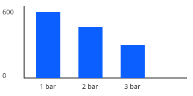

# Operation

During operation, watch the pressure gauge. Normal pressure is 2–3 bar.



## Adjusting the flow

Turn the throttle lever toward the hare symbol to increase the flow. The flow drops with suction height:
every metre of lift costs about 8 % of the maximum flow.[^lift]

```text
flow ≈ 600 L/min × (1 − 0.08 × lift in metres)
```

> [!TIP]
> Keep the suction hose as short as possible. A shorter hose primes faster.

## Troubleshooting

| Symptom                  | Likely cause          | Action                          |
| ------------------------ | --------------------- | ------------------------------- |
| Engine does not start    | Choke or fuel valve   | Check both, then retry          |
| No water after 1 minute  | Air leak in the hose  | Tighten the hose coupling       |
| Pressure drops slowly    | Clogged strainer      | Clean the strainer              |

For anything else, contact your supervisor or write to <mailto:support@example.org>.

[^lift]: Measured at sea level with a 5 m hose.
